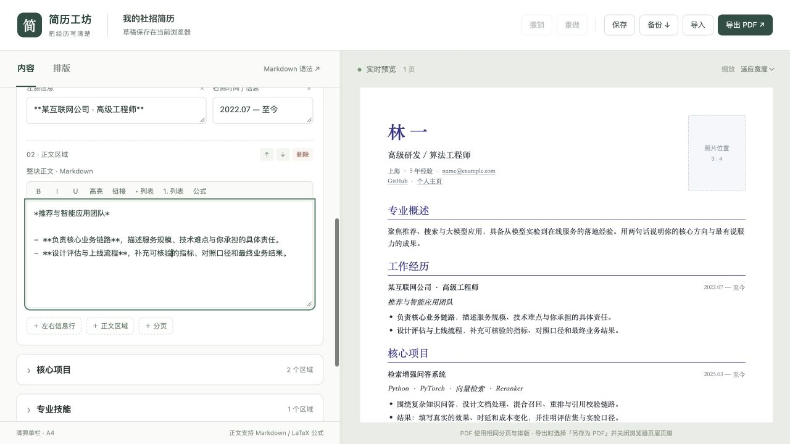

# auto-resume · 简历工坊

一个面向中文研发 / 算法岗位的简历编辑器。清爽单栏、照片位、整块 Markdown 正文、自由组合的模块和 A4 PDF 导出。

纯静态应用，无需注册或配置 API Key；简历草稿保存在当前浏览器。可在本地运行，也可自行部署到静态托管服务。



> 截图和初始内容均为虚构示例。首次打开即可编辑。

## 能做什么

- **自由组织模块**：新增、删除、排序、复制模块；模块标题可以单独删除和恢复。
- **信息行自由拆分**：公司 / 项目名称与右侧时间分别可删；不需要时可删除整行。
- **正文整块编辑**：一个输入区写多个段落和列表，不把每一行拆成表单。
- **Markdown 与公式**：有序 / 无序列表、链接、加粗、斜体、高亮、下划线、表格、代码块、任务列表、脚注与 KaTeX 公式。
- **照片与排版**：上传照片、调整位置和形状；全局字体、字号、行距、段落 / 列表 / 模块间距、页边距和标题颜色。
- **保存与恢复**：自动保存、手动保存、撤销 / 重做、包含照片和排版的 JSON 备份与导入。
- **A4 实时分页**：长正文自动分页，也可插入手动分页；编辑区宽度可拖动调整。
- **两种 PDF**：浏览器打印生成文字版，或直接下载保持当前版式的图片版。

## 快速开始

需要 Node.js 22 或以上版本。

```bash
git clone https://github.com/tqzhong/auto-resume.git
cd auto-resume
npm ci
npm run build
npm start
```

打开 **http://127.0.0.1:8765**。按需使用 `RESUME_PORT=9000 npm start` 更换端口。

`npm start` 提供已构建的文件；修改源码后需重新执行 `npm run build` 并刷新页面。

## 编辑与导出

1. 在「基本信息与照片」中填写姓名、方向、联系方式和照片。
2. 展开工作经历等模块，编辑标题、左右信息行和整块正文。写专业技能时，删除左右信息行，只保留标题和正文即可。
3. 在「排版」中统一调整字号、间距和留白，观察右侧 A4 分页。
4. 点击「备份」保存 `.resume.json`；以后用「导入」恢复全部内容。
5. 点击「导出 PDF」，选择适合的导出方式。

| 导出方式       | 适用场景               | 说明                                                                                 |
| -------------- | ---------------------- | ------------------------------------------------------------------------------------ |
| 文字版 · 推荐  | 正式投递、需要复制文字 | 打开浏览器打印，选择「另存为 PDF」。使用 A4、100% 缩放，关闭页眉页脚，开启背景图形。 |
| 直接下载图片版 | 快速预览、分享固定版式 | 无需打印窗口；保留链接，但正文是图片，文字不可选择。                                 |

如果内嵌浏览器无法打开打印窗口，可在 Chrome、Edge 或 Safari 中打开同一站点，导入备份后导出文字版。

### Markdown 示例

```markdown
**重点结果**、_斜体说明_、==高亮==、++下划线++、~~删除线~~

- 负责服务架构与性能优化
- 项目链接：[仓库](https://github.com/your-name/project)

1. 设计实验并验证指标
2. 推进上线与监控

行内公式：$F_1=\frac{2PR}{P+R}$

$$
L = -\sum_i y_i \log p_i
$$
```

下划线是 `++文字++` 扩展语法。HTML 标签按文本显示；正文中的远程图片显示为替代文字，照片请使用页眉的上传入口。数学公式支持范围由 KaTeX 决定。

## 数据保存

- 草稿和照片保存在浏览器的 `localStorage`，按站点区分；编辑器没有把简历上传到服务器的功能。
- 没有账号系统或跨设备云同步。更换浏览器、端口、域名、设备，或清除网站数据后，都需要用备份导入。
- 照片会在浏览器内缩小，随草稿和备份保存。浏览器存储空间不足时会提示下载备份。
- `.resume.json` 包含完整简历和照片，应当作为个人文件保管；不要提交到公开仓库。
- 支持从本应用的 JSON 备份恢复，不支持从 PDF 反向导入编辑。

## 自行部署

执行 `npm ci && npm run build`，将 **`dist/` 的全部内容**部署到任意静态文件服务器，例如 GitHub Pages、Nginx 或静态托管平台。

- 构建入口是 `dist/index.html`，没有服务端 API，也无需环境变量。
- 资源路径为相对路径，可部署到站点根目录或 `/auto-resume/` 等子路径。
- Markdown、公式、分页组件及 KaTeX 字体均包含在构建目录中，运行时不依赖外部 CDN。
- 请保留输出中的 `LICENSE.txt`、`THIRD-PARTY-NOTICES.txt` 和 `app.js.LEGAL.txt`。
- 不支持直接双击 HTML 以 `file://` 方式使用；请通过 HTTP(S) 访问。

仓库自带测试与构建 CI；公开站点的部署由使用者自行配置。

## 开发

```text
src/           编辑器交互、文档模型、Markdown 渲染
public/        HTML、编辑器样式、A4 简历样式
scripts/       构建与本地静态服务器
tests/         备份、输入约束、排序与 Markdown 测试
docs/          示例截图
dist/          生成的静态站点，不提交 Git
```

```bash
npm run format:check
npm test
npm run build
```

更多说明见 [CONTRIBUTING.md](CONTRIBUTING.md)。

目前已验证草稿保存与恢复、照片备份往返、模块内部增删、所列 Markdown / 公式渲染，以及单页和三页图片 PDF 导出。系统打印对话框中的最终文字版保存仍需人工验证。中文字体使用系统字体栈，不同系统的字体与分页可能略有差异。

## 开源组件与许可

独立实现的编辑器，复用了以下开源组件：

- [markdown-it](https://github.com/markdown-it/markdown-it) 与扩展：Markdown。
- [KaTeX](https://katex.org/)：数学公式。
- [Paged.js](https://pagedjs.org/)：A4 分页。
- [DOMPurify](https://github.com/cure53/DOMPurify)：内容过滤。
- [jsPDF](https://github.com/parallax/jsPDF) 与 [html2canvas](https://html2canvas.hertzen.com/)：图片版 PDF。
- [esbuild](https://esbuild.github.io/)：静态构建。

项目代码采用 [MIT License](LICENSE)。第三方组件仍适用各自的许可，构建过程会收集运行依赖的许可文件。
