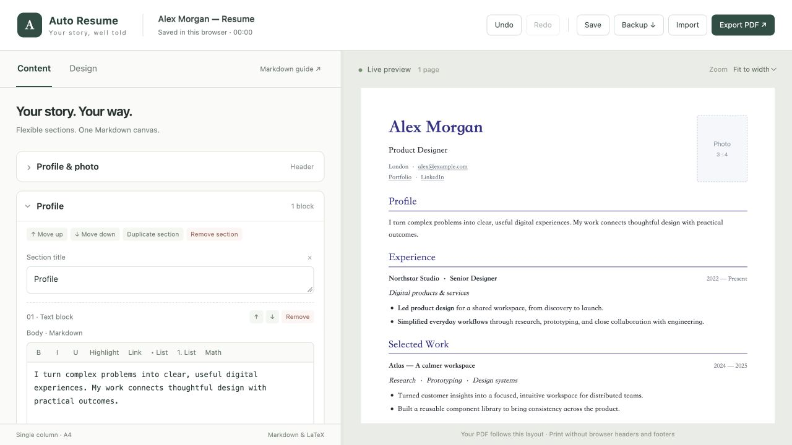

# Auto Resume

**Your story, beautifully composed.**

A minimal résumé editor with Markdown, flexible sections, and live A4 previews. Shape the content, refine the typography, and make every page your own.



## Made for the details

- **Flexible structure** — Add, rearrange, or remove sections and individual fields.
- **Expressive writing** — Markdown, links, lists, highlights, and mathematical notation.
- **Precise layout** — Fine-tune typography and spacing, with adaptive photos and automatic pagination.
- **Portable drafts** — Automatic browser saves, undo and redo, and complete JSON backups.
- **PDF export** — Print to a text PDF, or download an image PDF directly.

Your drafts stay in your current browser. Use JSON backups to move between browsers or devices.

## Get started

Requires Node.js 22 or later.

```bash
git clone https://github.com/tqzhong/auto-resume.git
cd auto-resume
npm ci
npm run build
npm start
```

Open [localhost:8765](http://127.0.0.1:8765). Rebuild after editing the source.

To host it yourself, deploy the generated `dist/` directory to any static host, including its license files. No backend or API keys required.

[Contributing](CONTRIBUTING.md) · [MIT License](LICENSE)
